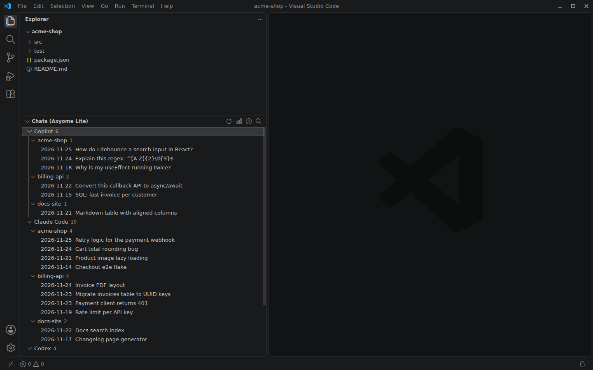
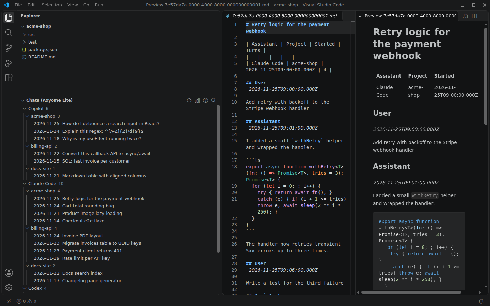
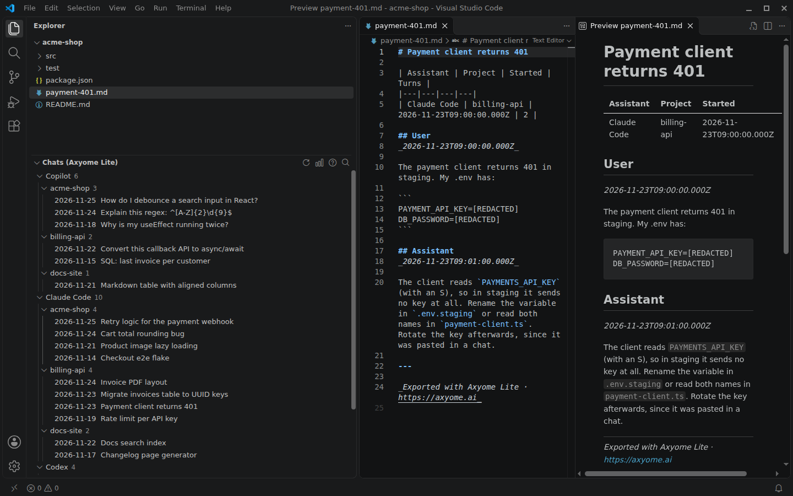
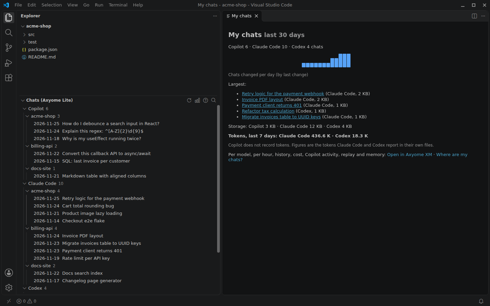

<div align="center">
  <h1>Axyome Lite</h1>
  <p><strong>Find, open and export your Copilot, Claude Code and Codex chats. Free and open source.</strong></p>
  <p>
    <a href="https://marketplace.visualstudio.com/items?itemName=axyome-ai.axyome-lite"></a>
    <a href="https://open-vsx.org/extension/axyome-ai/axyome-lite"></a>
  </p>
  <p>Local only · no account · nothing sent anywhere · MIT licence</p>
</div>



## Get started

| | |
|---|---|
| [Install](docs/install.md) | VS Code, Cursor, Windsurf, VSCodium, or the command line |
| [First five minutes](docs/onboarding.md) | find your chats, open one, export it, see your usage |
| [Tutorials](docs/tutorials/README.md) | find a lost chat, share a chat safely, back up every chat, see your AI usage |
| [FAQ](docs/faq.md) | where the files are, privacy, limits |

---

## Where is my Copilot chat history?

Your AI assistants already keep every chat on your computer. They are just hard to find:

| Assistant | Windows | macOS | Linux |
|---|---|---|---|
| **GitHub Copilot** (VS Code) | `%APPDATA%\Code\User\workspaceStorage\<id>\chatSessions` | `~/Library/Application Support/Code/User/workspaceStorage/<id>/chatSessions` | `~/.config/Code/User/workspaceStorage/<id>/chatSessions` |
| Copilot chats with no folder open | `…\Code\User\globalStorage\emptyWindowChatSessions` | same, under `Code/User/globalStorage` | same, under `Code/User/globalStorage` |
| **Claude Code** | `%USERPROFILE%\.claude\projects\<project>\<session>.jsonl` | `~/.claude/projects/<project>/<session>.jsonl` | `~/.claude/projects/<project>/<session>.jsonl` |
| **Codex** | `%USERPROFILE%\.codex\sessions\YYYY\MM\DD\rollout-*.jsonl` (or `$CODEX_HOME`) | `~/.codex/sessions/…` | `~/.codex/sessions/…` |

Axyome Lite finds them for you, on Windows, macOS and Linux.

## What it does

- **Where are my chats?** One command lists every folder above that exists on your computer, with the number of chats and their size.
- **Browse.** A **Chats** view in the Explorer: assistant → project → conversation, newest first.
- **Open.** Any conversation opens as a clean, read-only Markdown page.
- **Export.** Save a conversation as a `.md` file, or copy it as Markdown. Secrets (API keys, tokens, JWTs, IDs, `password=` values) are replaced with `[REDACTED]` by default.
- **My chats.** One page with your chats per assistant and per day, your largest chats, the disk space each assistant uses, and the tokens Claude Code and Codex used in the last 7 days. Copilot does not record tokens, so none are shown for it.

Exports are complete: long replies are never cut.

## Screenshots

**Open any chat as Markdown**



**Export it with secrets replaced**



**My chats: your chats, storage and tokens on one page**



## Command line

The same features, in a terminal:

```text
npx axyome-lite where                       where each assistant keeps its chats
npx axyome-lite list --assistant claude     your Claude Code sessions, newest first
npx axyome-lite export claude:<id> -o chat.md
npx axyome-lite stats                       chats, storage, tokens of the last 7 days
```

`npx axyome-lite --help` lists every option.

## Want more? Axyome XM

Axyome Lite finds and exports chats. **[Axyome XM](https://marketplace.visualstudio.com/items?itemName=axyome-ai.axyome-ai-xm)** remembers your whole coding history: it searches every chat, replays any coding day, shows your AI usage per model and per hour, and gives Copilot and Claude Code a memory of what you actually did. When Axyome XM is installed, **Search all chats** in Axyome Lite opens it.

## Privacy

- Axyome Lite only **reads** the chat files listed above. It never changes or deletes them.
- It makes **no network calls**, has **no telemetry** and needs **no account**.
- It keeps no database, cache or log. The only file it writes is the export you choose. VS Code remembers one setting for it: whether the one-time Axyome XM tip was already shown.

## Settings

| Setting | Default | What it does |
|---|---|---|
| `axyomeLite.export.redactSecrets` | `true` | Replace secrets with `[REDACTED]` in previews, exports and copies |
| `axyomeLite.export.footer` | `true` | Add one line, "Exported with Axyome Lite", at the end of an export |
| `axyomeLite.extraVsCodeUserDirs` | `[]` | More VS Code user folders to search (portable installs) |
| `axyomeLite.codexHome` | `""` | Codex home folder; empty means `$CODEX_HOME`, else `~/.codex` |
| `axyomeLite.dashboard.days` | `30` | Days in the chats-per-day chart |

## Limits

- Copilot chats above 64 MB are listed but not opened. Axyome XM opens chats of any size.
- Cursor's own chat panel keeps its chats in a different format and is not read.
- Claude Code subagent transcripts are not listed separately.

## Contributing

Issues and pull requests are welcome on [GitHub](https://github.com/axyome-ai/axyome-lite/issues).

— Axyome.ai Team
