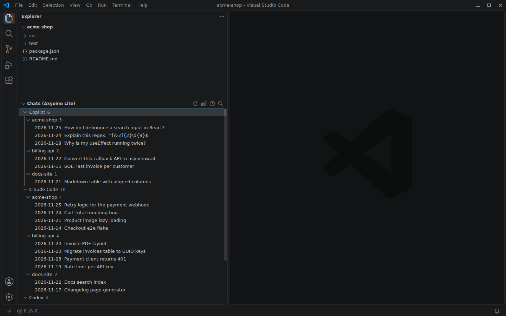
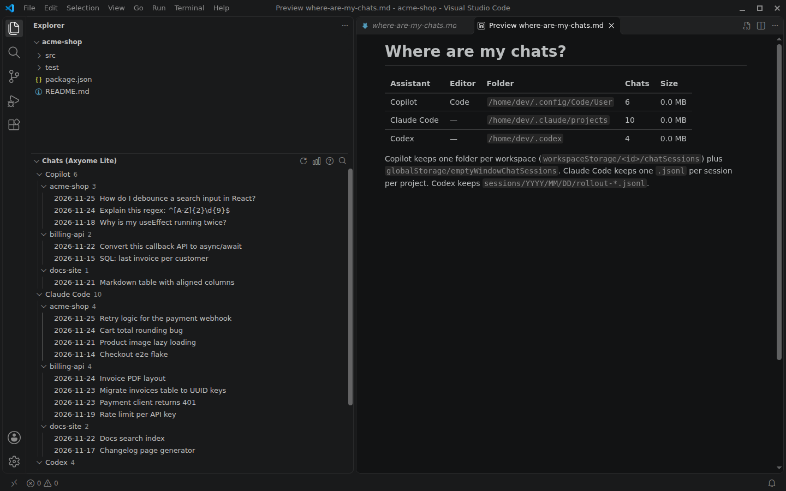
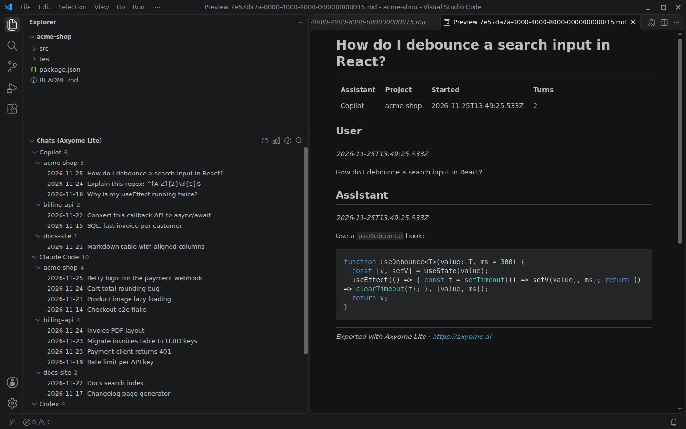
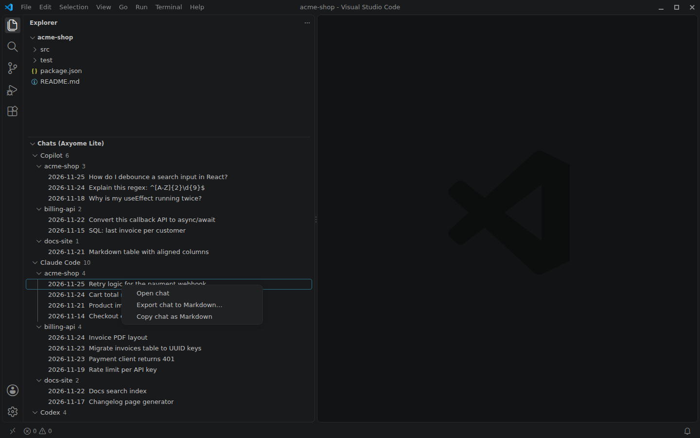
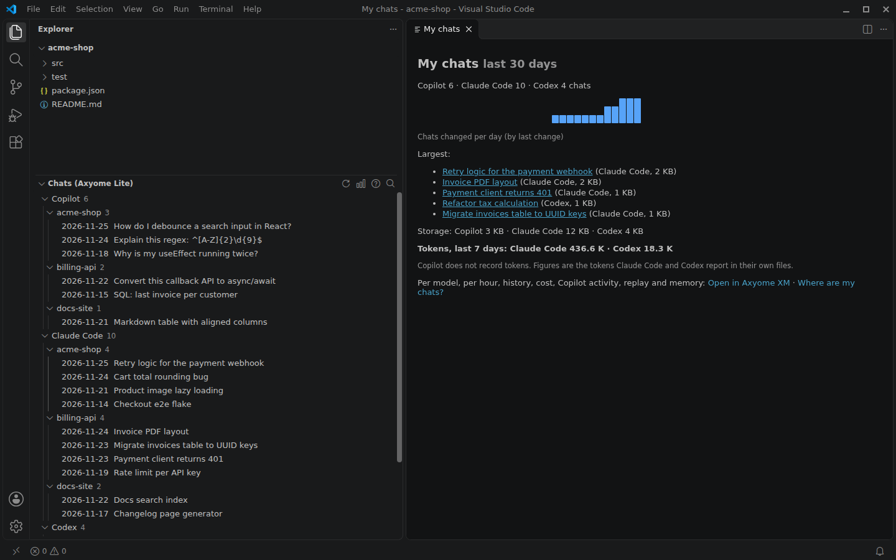

# The first five minutes

Five short steps, from installing Axyome Lite to your first export. Not installed yet? See [Install](install.md).

The screenshots use invented demo chats.

## 1. Open the Chats view

Open the Explorer (`Ctrl+Shift+E`, or `Cmd+Shift+E` on macOS). The **Chats (Axyome Lite)** section lists every chat
it found:

- first by assistant (Copilot, Claude Code, Codex), with the number of chats;
- then by project folder;
- then one line per chat, newest first, with the date of its last change and its title.

Copilot chats started with no folder open are grouped under **(no folder)**.

The four buttons at the top of the view are **Refresh**, **My chats**, **Where are my chats?** and **Search all
chats**. Click **Refresh** after a new chat, to see it in the list.

## 2. See where your chats are kept

Click **?** (**Where are my chats?**). A page lists each folder Axyome Lite checked, with the number of chats and
their size on disk.

If an assistant is missing, this page shows the folder that was checked. For a portable VS Code, add its user folder
in the setting `axyomeLite.extraVsCodeUserDirs`. For Codex in a custom location, set `axyomeLite.codexHome`.

## 3. Open a chat

Click any chat. It opens as a read-only Markdown page: a short header (assistant, project, start time, turns), then
every message in order. Code blocks stay code blocks.

To see the formatted page, use **Open Preview** (`Ctrl+Shift+V` or `Cmd+Shift+V`).

## 4. Export or copy it

Right-click a chat:

- **Export chat to Markdown…** saves it as a `.md` file where you choose;
- **Copy chat as Markdown** puts it on the clipboard, ready to paste into an issue, a pull request or a note.

Secrets in the chat (API keys, tokens, passwords) are replaced with `[REDACTED]` in exports, copies and previews.
See [Share a chat safely](tutorials/share-a-chat-safely.md).

## 5. See your usage

Click the chart button (**My chats**). One page shows your chats per assistant, the chats changed per day, your
largest chats, the disk space each assistant uses, and the tokens Claude Code and Codex used in the last 7 days.

## Next

- [Tutorials](tutorials/README.md): find a lost chat, share a chat safely, back up every chat, see your AI usage.
- [FAQ](faq.md): where the files are, privacy, limits.

— Axyome.ai Team
