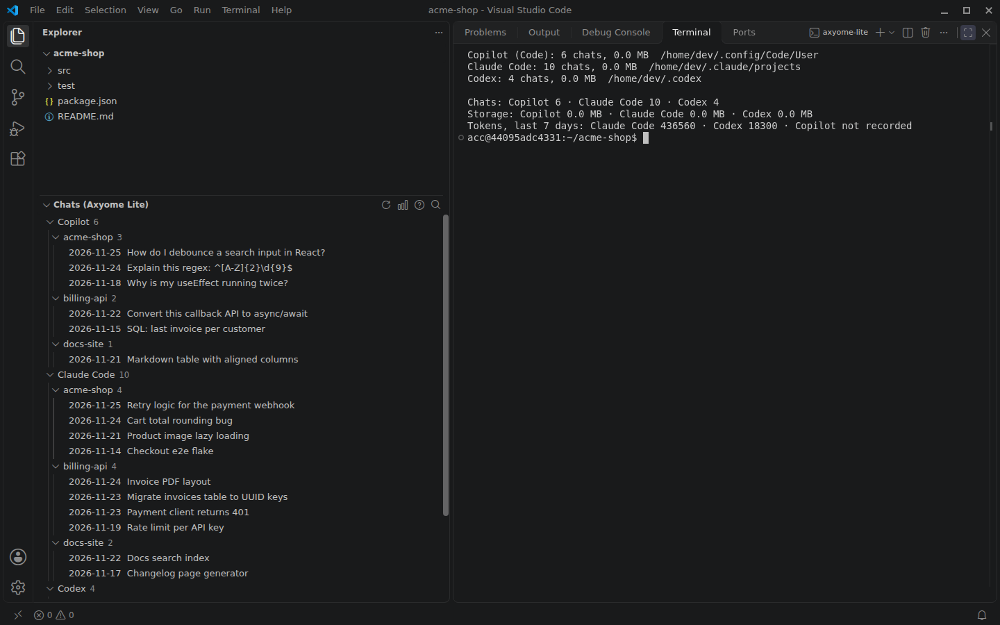

# Back up every chat from the terminal

**Level:** Intermediate · **Time:** 15 minutes · **You need:** Node.js 18 or later, and a terminal (bash, zsh or
PowerShell)

Your assistants keep their chats in their own folders, in their own formats, and some delete old ones. This tutorial
exports every chat to a plain Markdown file in a folder you own, then repeats it each week for the new ones.

## 1. Install the command

```text
npm install -g axyome-lite
axyome-lite --version
```

(Or put `npx` in front of every command below instead of installing.)

## 2. See what will be backed up

```text
axyome-lite where
```

prints one line per assistant, with the number of chats, their size and the folder they are in:

```text
Copilot (Code): 6 chats, 0.0 MB  /home/dev/.config/Code/User
Claude Code: 10 chats, 0.0 MB  /home/dev/.claude/projects
Codex: 4 chats, 0.0 MB  /home/dev/.codex
```



## 3. List the chats as JSON

```text
axyome-lite list --json
```

gives one entry per chat, newest first:

```json
{
  "id": "copilot:7e57da7a-0000-4000-8000-000000000015",
  "assistant": "copilot",
  "project": "acme-shop",
  "changed": "2026-11-25T13:53:03.165Z",
  "size": 626,
  "title": "How do I debounce a search input in React?",
  "file": "/home/dev/.config/Code/User/workspaceStorage/demo0/chatSessions/7e57da7a-0000-4000-8000-000000000015.json"
}
```

`id` is what `export` needs; `title` and `project` are the ones the Chats view shows. `--assistant copilot|claude|codex`
keeps one assistant only. Without `--json`, `list` prints one line per chat: ID, date, folder and title.

## 4. Export every chat

**bash or zsh** (Linux, macOS, Git Bash):

```bash
mkdir -p ~/chat-backup
axyome-lite list --json \
  | node -e 'for (const c of JSON.parse(require("fs").readFileSync(0, "utf8"))) console.log(c.id)' \
  | while read -r id; do
      axyome-lite export "$id" -o ~/chat-backup/"${id/:/-}".md --force > /dev/null
    done
ls ~/chat-backup | wc -l
```

**PowerShell** (Windows):

```powershell
New-Item -ItemType Directory -Force "$HOME\chat-backup" | Out-Null
$chats = (axyome-lite list --json | Out-String) | ConvertFrom-Json
foreach ($c in $chats) {
  axyome-lite export $c.id -o "$HOME\chat-backup\$($c.id -replace ':', '-').md" --force | Out-Null
}
(Get-ChildItem "$HOME\chat-backup").Count
```

Each chat becomes one file, named after its assistant and ID, for example
`claude-7e57da7a-0000-4000-8000-000000000001.md`. The count at the end is the number of files in the folder.

Secrets in the chats are replaced with `[REDACTED]`, as in every export. `--force` lets the next run update a chat
that has grown since.

## 5. Next week: only the new ones

`--since` keeps the chats changed on or after a date:

```bash
axyome-lite list --since 2026-11-18 --json
```

Use it in the same loop instead of `list --json`. Run it by hand each week, or from cron (Linux, macOS) or Task
Scheduler (Windows).

## Good to know

| Exit code | Meaning |
|---|---|
| 0 | done |
| 1 | wrong command or option |
| 2 | chat not found |
| 3 | chat unreadable, unsupported, or larger than 64 MB |
| 4 | refused: the file exists (add `--force`) or the target is inside an assistant's chat folder |

- `axyome-lite export <id> --stdout` prints the Markdown instead of writing a file.
- Axyome Lite never writes into an assistant's own chat folders, so a backup can never damage the chats.
- In a portable VS Code, set `AXYOME_LITE_EXTRA_DIRS` to its user folder before running the commands.

— Axyome.ai Team
