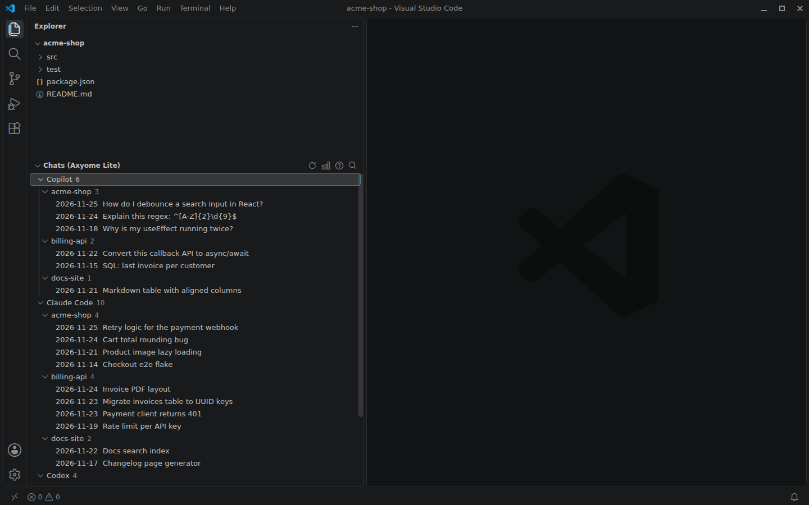
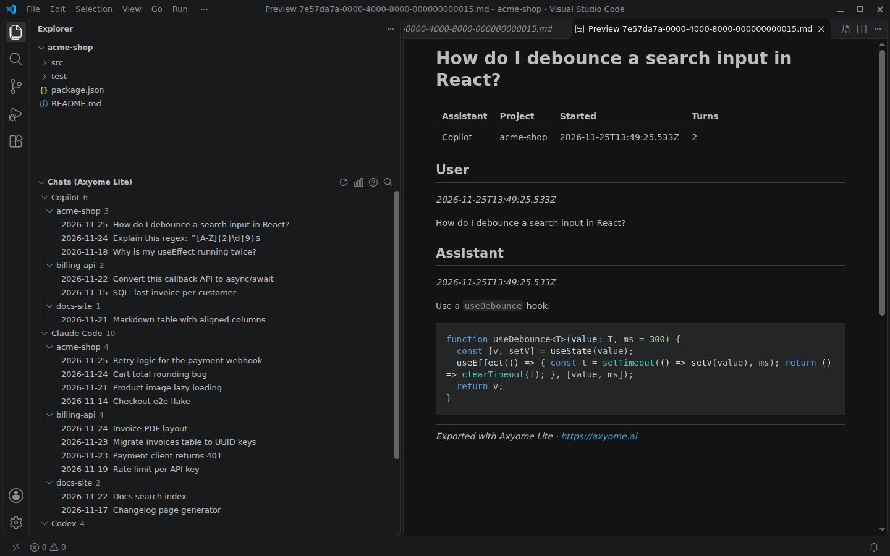

# Find a lost chat

**Level:** Beginner · **Time:** 5 minutes · **You need:** Axyome Lite installed ([Install](../install.md))

Last week Copilot gave you a good answer, and now you cannot remember in which project, or when. Axyome Lite lists
every chat of every project in one place.

## 1. Open the Chats view

Open the Explorer (`Ctrl+Shift+E`, or `Cmd+Shift+E` on macOS) and expand **Chats (Axyome Lite)**.

## 2. Go to the assistant and the project

Expand **Copilot**, then the project folder you were working in. Chats are sorted newest first, and each line starts
with the date of its last change.

Not sure which project? Every project of that assistant is listed, even the ones that are not open now. Copilot
chats started with no folder open are under **(no folder)**.

Tip: click inside the Chats view and start typing part of the title. VS Code highlights the matching lines among the
expanded groups.

## 3. Open it

Click the chat. It opens as a Markdown page with every message, in order. Open the preview (`Ctrl+Shift+V` or
`Cmd+Shift+V`) to read it formatted.

## 4. Keep what you need

Right-click the chat and choose **Copy chat as Markdown** to paste it into a note, or **Export chat to Markdown…** to
save it as a file.

## It is not in the list

- Click **Refresh** at the top of the Chats view.
- Click **?** (**Where are my chats?**) to see which folders were checked. A portable VS Code keeps its chats in its
  own folder: add it in the setting `axyomeLite.extraVsCodeUserDirs`.
- Axyome Lite lists chats by title and date; it does not search inside them. To search the text of every chat, use
  **Search all chats**, which opens Axyome XM.

Next: [Share a chat safely](share-a-chat-safely.md).

— Axyome.ai Team
