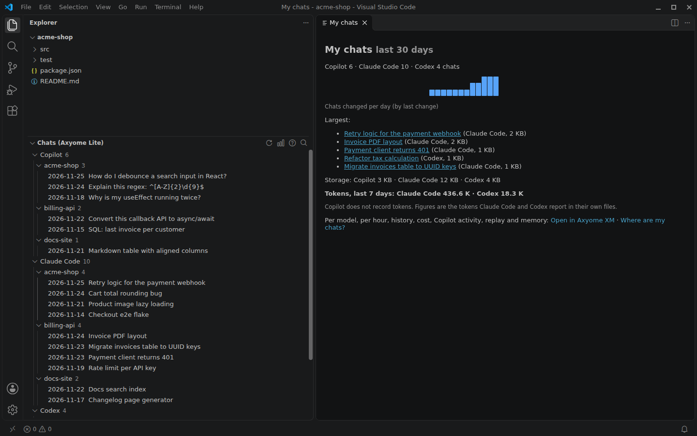

# See your AI usage

**Level:** Beginner · **Time:** 5 minutes · **You need:** Axyome Lite installed

How much do you use each assistant? Which chats are huge? How many tokens did Claude Code use this week? One page
answers.

## 1. Open My chats

Click the chart button at the top of the Chats view, or run **Axyome Lite: My chats** from the Command Palette
(`Ctrl+Shift+P` or `Cmd+Shift+P`).



## 2. Read the page

| Line | What it shows |
|---|---|
| **Copilot · Claude Code · Codex** | how many chats each assistant keeps on this computer |
| The bar chart | how many chats changed each day, over the last 30 days (by each chat's last change) |
| **Largest** | your five largest chats; click one to open it |
| **Storage** | the disk space each assistant's chats use |
| **Tokens, last 7 days** | the tokens Claude Code and Codex used in the last 7 days. Hover the line to see input, output, cache read and cache write |

The counts show at once. The token line can take a few seconds on a large history: it says "counting…" until then.

Copilot does not record tokens in its chat files, so there is no token figure for it.

## 3. Change the period of the chart

Set `axyomeLite.dashboard.days` (default `30`) to show more or fewer days, then open the page again.

## From the terminal

```text
axyome-lite stats
```

prints the chats per assistant, the storage and the tokens of the last 7 days, for example:

```text
Chats: Copilot 6 · Claude Code 10 · Codex 4
Storage: Copilot 0.0 MB · Claude Code 0.0 MB · Codex 0.0 MB
Tokens, last 7 days: Claude Code 436560 · Codex 18300 · Copilot not recorded
```

`axyome-lite stats --json` also gives the chats per day and the largest chats, for your own charts or scripts.
`--days 90` changes the period of the per-day counts.

Next: [Back up every chat from the terminal](back-up-all-chats-from-the-terminal.md).

— Axyome.ai Team
