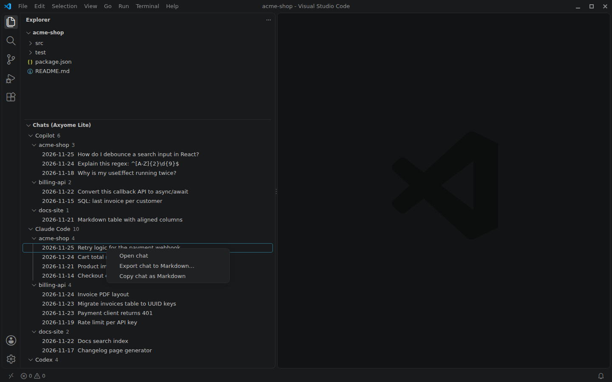
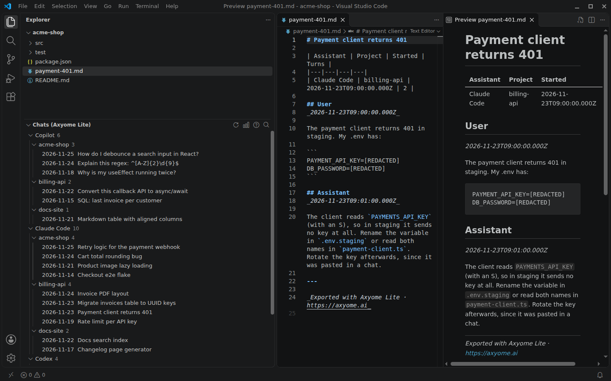

# Share a chat safely

**Level:** Beginner · **Time:** 10 minutes · **You need:** Axyome Lite installed, and a Claude Code (or Copilot, or
Codex) chat you want to share

A chat with Claude Code explains why a change was made, and you want to attach it to a pull request or a ticket. But
chats often contain things you pasted without thinking: an `.env` line, a token, a password. Axyome Lite replaces them
before the chat leaves your computer.

## 1. Export the chat

In the Chats view, right-click the chat and choose **Export chat to Markdown…**.



Choose where to save it. The suggested file name is the chat's title.

## 2. Check what was replaced

Open the file. Every secret Axyome Lite recognised is now `[REDACTED]`. In this example the chat contained an API key
and a database password:



Search the file for `[REDACTED]` (`Ctrl+F` or `Cmd+F`) to see each place.

What is replaced: AWS access keys, GitHub tokens, OpenAI and Anthropic API keys, Slack tokens, JSON web tokens, IDs in
the UUID format, and the value after `password`, `secret`, `token`, `api_key` and similar names followed by `=` or `:`.

**Read the file anyway before you share it.** Redaction matches patterns, so a secret in an unusual format, a customer
name or an internal address stays as it is.

## 3. Share it

Attach the `.md` file, or paste its content into the pull request or the ticket. Markdown keeps the headings and the
code blocks. If you only need a quick paste, **Copy chat as Markdown** gives the same redacted text through the
clipboard.

## 4. Adjust the output (optional)

| Setting | Default | Effect |
|---|---|---|
| `axyomeLite.export.redactSecrets` | `true` | Turn off only if you need the exact text, for example for your own archive |
| `axyomeLite.export.footer` | `true` | Removes the last line, "Exported with Axyome Lite", when turned off |

## From the terminal

```text
axyome-lite export <id> -o chat.md
```

Take `<id>` from `axyome-lite list`. `--no-footer` leaves out the last line. `--no-redact` keeps secrets and prints a
warning. The command never overwrites a file without `--force`, and refuses to write inside an assistant's chat
folder.

Next: [See your AI usage](see-your-ai-usage.md).

— Axyome.ai Team
